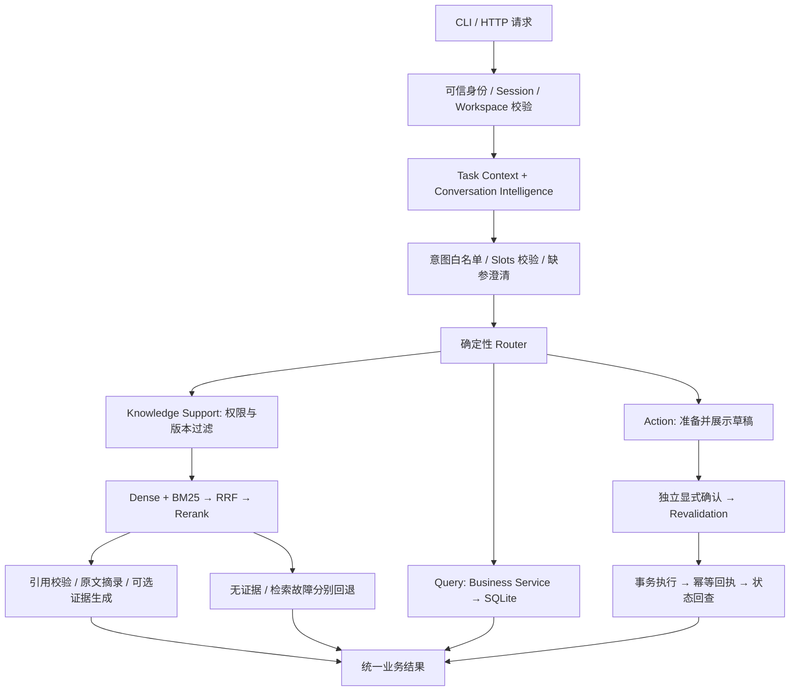

# SaaS Support Agent

面向电商商家售后的 RAG + Agent 客服系统。知识咨询有可定位的政策证据；订单与工单状态从 SQLite 查询；通知修改和售后工单必须经过明确确认，再由业务事务执行。

**当前版本：本机单进程、合成业务数据、Milvus Lite 默认检索。可选 LLM 适配已实现，真实模型端到端未验收；云端 Milvus 与生产身份认证未验收。** 不接真实电商平台，不自动退款，不代表已接通人工客服。

## 实际能力

| 分支 | 已实现 |
|---|---|
| Knowledge | 版本化 Markdown / 文本 PDF 解析、切分、真实本地 Embedding、Dense + 中文 BM25 + RRF、Rerank、来源/页码/章节引用、无证据与检索故障区分 |
| Query | 授权店铺订单、本人工单状态、Workspace 内个人通知设置查询 |
| Action | 工单准备/补参/修订/确认/取消/恢复/结果核对，通知修改；事务、幂等与持久化回执 |
| Conversation Intelligence | 离线固定句式；可选模型意图/Slots/自评分校验；有限 Task Context，最多一个待办写操作 |
| HTTP | FastAPI 请求与响应契约、演示令牌映射身份、Session 归属、独立确认接口、错误映射与最小日志 |

不实现自主规划、Multi-Agent、Text-to-SQL、退款支付或完整登录系统。Task Context 不等于长期 Memory；草稿与 Session 重启失效。

## 完整调用链



模型仅提出业务意图，不执行任意工具。确认绑定具体草稿、版本和展示摘要；参数或相关状态变化会使旧确认失效。模型不能生成有效授权。`succeeded` 表示业务函数成功，工单 `waiting_for_agent` 只表示待人工受理，不代表批准退货或退款。

## 环境与最小离线演示

已验证 macOS Apple Silicon、Python 3.14.7，使用 uv；其他系统未验收。依赖由 `uv.lock` 固定，从 `src` 运行，不要求安装项目包。

```bash
uv sync --locked
SAAS_LLM_ENABLED=0 PYTHONPATH=src uv run --locked python -B \
  -m saas_support_agent.merchant_demo --demo
```

此模式使用固定句式和明确标注的静态示例政策，不是语义检索或真实 LLM。每次 CLI 创建临时合成 SQLite，退出清理。去掉 `--demo` 可交互：

- `退货超期能不能受理？`
- `查询订单 ORD-1001`
- `创建售后工单 ORD-1001，原因：需要人工核对超期情形`
- `/补充 原因：需要人工核对`，以及 `/恢复`、`/取消`、`/核对`
- 核对展示摘要后输入 `/确认 <操作编号>`；HTTP 不能通过聊天执行此命令。
- `查询工单 <返回编号> 状态`
- `关闭任务指派邮件通知`、`查询任务指派邮件通知`

查询插入后恢复写任务须重新校验。第二个写请求不能静默覆盖原待办。

## 真实本地 RAG

首次依赖与模型下载需要联网；已准备好后可离线运行。权重不在 Git 仓库中，不使用随机向量。

```bash
uv sync --locked --extra rag --extra api
HF_HOME=runtime/rag/huggingface HF_HUB_DISABLE_IMPLICIT_TOKEN=1 PYTHONPATH=src \
  .venv/bin/python -B -m saas_support_agent.knowledge.models
# 首次建立本地索引。后续读取已有索引时去掉 --rebuild-index。
SAAS_LLM_ENABLED=0 HF_HUB_OFFLINE=1 PYTHONPATH=src .venv/bin/python -B \
  -m saas_support_agent.merchant_demo --rag --rebuild-index --demo
```

官方下载大文件失败时可在模型准备命令后追加 `--ranged`，使用系统 curl 与已有代理从同一官方快照分段下载，并校验完整 SHA-256。索引/模型在被忽略的 `runtime/` 下。服务启动不会自动下载或重建；政策目录、版本或来源内容变化需显式重建。

## HTTP API

仅本机单进程运行。令牌映射合成用户；不是生产认证。应用不自动读取 `.env`，配置从进程环境传入。不要公网部署、多个 worker 或自动 reload。

```bash
# 只创建新文件，已有数据库拒绝覆盖。
PYTHONPATH=src .venv/bin/python -B -m saas_support_agent.api.demo
export SAAS_DEMO_CLIENT_TOKEN="$(.venv/bin/python -c 'import secrets; print(secrets.token_urlsafe(32))')"
export SAAS_DEMO_TOKENS="{\"$SAAS_DEMO_CLIENT_TOKEN\":\"demo-merchant\"}"
export SAAS_DATABASE=runtime/http-demo.sqlite3
export SAAS_RAG_ENABLED=1
export SAAS_LLM_ENABLED=0
export HF_HUB_OFFLINE=1
PYTHONPATH=src .venv/bin/python -B -m uvicorn saas_support_agent.api.app:local_app \
  --factory --host 127.0.0.1 --port 8000 --workers 1 --no-access-log
```

在第二个终端配置**同一临时令牌**后运行 `.venv/bin/python -B scripts/demo_http.py`。也可打开 `http://127.0.0.1:8000/docs`，在 Authorize 填入该令牌。

| 路径 | 方法与用途 |
|---|---|
| `/v1/sessions` | POST，创建绑定身份和 Workspace 的 Session |
| `/v1/sessions/{id}/messages` | POST，咨询、查询或发起办理 |
| `/v1/sessions/{id}/task` | GET，当前任务 |
| `/v1/sessions/{id}/task/slots` | PATCH，明确补参或修正 |
| `/v1/sessions/{id}/task/confirm` | POST，提交已展示的确认绑定 |
| `/v1/sessions/{id}/task/cancel`、`resume`、`reconcile` | POST，取消、重新校验展示、结果核对 |

示例请求（第二个终端具有同一令牌）：

```bash
curl -s http://127.0.0.1:8000/v1/sessions \
  -H "Authorization: Bearer $SAAS_DEMO_CLIENT_TOKEN" \
  -H 'Content-Type: application/json' -d '{"workspace_id":"demo-workspace"}'
# 将响应 session_id 填入 SID。
curl -s "http://127.0.0.1:8000/v1/sessions/$SID/messages" \
  -H "Authorization: Bearer $SAAS_DEMO_CLIENT_TOKEN" \
  -H 'Content-Type: application/json' \
  -d '{"text":"创建售后工单 ORD-1001，原因：超期需要人工核对"}'
```

核对 `draft.summary` 后，将 `draft.confirmation` 原样作为 JSON 正文提交到 `/task/confirm`。不能自报 user_id 冒充他人。返回 `receipt` 才是执行证据。完整错误映射及字段见 [HTTP 契约与验证](docs/http_3a_validation.md)。

## 可选模型适配

默认 `SAAS_LLM_ENABLED=0`，即使遗留地址和密钥也不会创建模型 HTTP 客户端。先确认厂商、完整 HTTPS 地址、模型和预算，才可配置 `.env.example` 列出的 `SAAS_LLM_ENDPOINT/MODEL/API_KEY` 并显式启用。**当前没有真实模型端到端验收。**

适配使用 HTTPX，不依赖厂商 SDK。协议为 `messages` 输入、`choices[0].message.content` JSON 输出，要求 `finish_reason=stop`；发送 `response_format=json_object`、`temperature=0`、`max_tokens=1200`。不是所有厂商都支持，需后续实测。无重定向或自动重试，不继承环境代理。

非法意图、未知字段、任意工具和身份字段被拒绝；低自评分澄清。理解模型故障只对已有固定句式回退，标记 `understanding_mode=offline_fallback`。生成故障/错引文退回原文，标记 `answer_mode=extractive_fallback`。无证据不生成；生成后再次校验权限和来源。引用匹配不保证解释语义正确，真实模型忠实性、识别质量、费用和时延均未验证。

## 质量与性能（本机合成样本）

2026-11-07：**120 项测试全部通过，无跳过**，包括真实本地检索和模型替身；不是实际生成式模型测试。固定 24 条原始问答、6 条边界，加 12 条误排问题相关的探索性对照（不是新的独立测试集）。

| 原 24 题 | Recall@5 | Hit@1 | 检索中位耗时 |
|---|---:|---:|---:|
| Dense | 91.67% | 21/24 | 7.52 ms |
| Dense + BM25 + RRF | 91.67% | 22/24 | 6.89 ms |
| 混合 + Rerank | 100% | 23/24 | 845.08 ms |

**Recall@5 不等于回答成功率。** 当前前 3 条证据和分数门槛下，原 24 题实际回答 19 题、5 题返回无证据；新增 12 题回答 12 题，但只有 11 题返回了全部标注证据。“签收八天”的正确条款重排第 5，最终无证据回退；未用硬编码修成满分。

真实 HTTP 计时：知识响应中位数 727.02 ms，订单单独查询 6.39 ms；另一 Session 重排期间订单查询中位数 690.02 ms，说明共享锁阻塞实际存在。五请求完整售后链路 714.17 ms，不含用户思考时间、首次模型加载或真实 LLM；不是吞吐/QPS 承诺。样本量、P95、失败分析见 [最终验收](docs/release_validation.md)。

```bash
# 完整本地集成回归：需要依赖、模型和现有索引，启动本机 Lite。
SAAS_LLM_ENABLED=0 HF_HUB_OFFLINE=1 SAAS_RAG_INTEGRATION=1 PYTHONPATH=src \
  .venv/bin/python -B -m unittest discover -s tests -v
# 不启动 Lite：112 项通过，8 项集成跳过。
SAAS_LLM_ENABLED=0 SAAS_RAG_INTEGRATION=0 PYTHONPATH=src \
  .venv/bin/python -B -m unittest discover -s tests -v
# 固定评测 + 章节标题实验 + 本机 HTTP 计时；输出路径必须不存在。
SAAS_LLM_ENABLED=0 HF_HUB_OFFLINE=1 PYTHONPATH=src .venv/bin/python -B \
  scripts/evaluate_release.py --output runtime/my-release-evaluation.json
```

保留第二阶段 [原始结果](docs/merchant_rag_eval_2026-11-06.json)，新增 [检索/HTTP 结果](docs/release_eval_2026-11-07.json) 和 [实际证据返回结果](docs/release_answerability_2026-11-07.json)。政策评测日期固定到 2026-11-06 以保持可比性；正常服务使用当前日期。

## 边界、来源与发布状态

- 合成政策不是任何真实电商平台规则或法律意见。工单只是本地登记，不代表已经接通人工。
- 本地单进程；无跨重启 Session/草稿恢复、生产认证、压力测试或云端验收。
- Milvus Lite 保持默认；云服务器上的 Milvus 是未来可选部署，不共用人才项目集合。
- 无前端、真实平台、自动退款、自主规划、Multi-Agent 或 ChatBI。
- 项目自有代码采用 [MIT License](LICENSE)，Copyright (c) 2026 liharlan07-sketch。第三方依赖和模型仍遵循各自许可证，权重不随仓库分发。

[发布审查](docs/publish_review.md) · [第三方许可与云端只读核对](docs/third_party_and_cloud.md) · [3B 替身验证](docs/llm_3b_validation.md)

历史设计与实现记录保留在 docs/。能力来源 Lingyu / SmartReading 仅作为 migration source 记载，不代表复制整套实现；不将第三方模型、库或 Codex 实现包装为用户手写原创。
