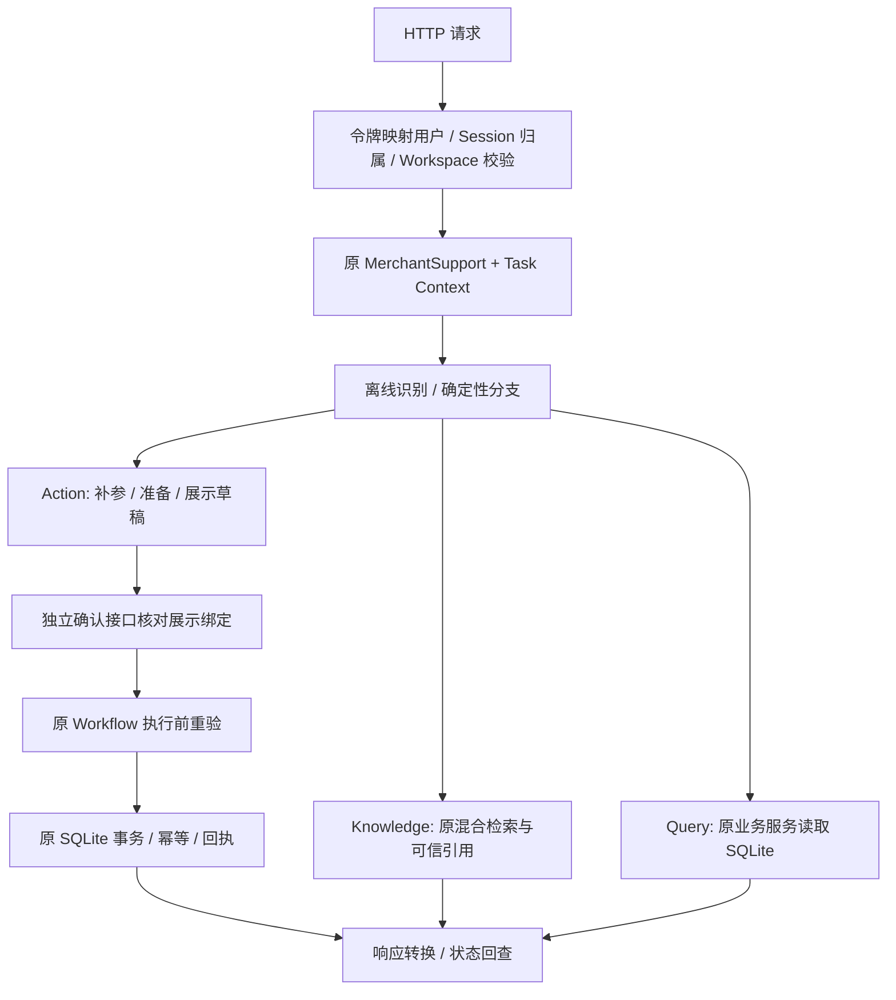

# 3A：HTTP 商家售后闭环

## Business Problem

将原有命令行业务通过 HTTP 暴露，使调用方可咨询政策、查订单、补齐工单参数、核对草稿并明确确认。聊天请求不得变成执行授权，所有写入仍由已有业务服务决定。

## Architecture Decision

沿用用户确认方案：本机单进程、FastAPI 薄入口、服务端演示令牌映射合成身份、内存 Session。每个业务请求重新核对令牌、Session 归属和 Workspace 成员关系，订单和政策范围继续由原服务校验。健康检查需要令牌；接口说明页公开供本机查看。

HTTP 消息使用 `allow_control=False`，CLI 维持原行为。显式确认提交服务端曾展示的 `task_id/pending_action_id/operation_id/revision/payload_hash`，与保存的绑定逐项核对；哈希包括完整草稿和展示摘要，不是认证凭证。随后调用原 TaskContextManager 和 Workflow。结果与展示快照在同一协调锁内生成。



## API 契约

所有业务请求携带 `Authorization: Bearer <本地演示令牌>`，身份不接受正文传入。Session 创建正文只允许 `workspace_id`；Session 由服务端生成并绑定用户和 Workspace。

| 方法与路径 | 正文 / 行为 |
|---|---|
| POST `/v1/sessions` | `{"workspace_id":"demo-workspace"}`，返回 201 和 session_id |
| POST `/v1/sessions/{id}/messages` | `{"text":"查询订单 ORD-1001"}`；政策/订单/工单/通知仍使用原离线句式 |
| GET `/v1/sessions/{id}/task` | 当前活跃任务；不会自动恢复确认 |
| PATCH `/v1/sessions/{id}/task/slots` | `{"task_id":"…","slots":{"order_id":"ORD-1001","description":"超期核对"}}` |
| POST `/v1/sessions/{id}/task/confirm` | 将已阅读的 `draft.confirmation` 原样提交 |
| POST `/v1/sessions/{id}/task/cancel` | `{"task_id":"…"}`；执行结果不确定时不能取消 |
| POST `/v1/sessions/{id}/task/resume` | `{"task_id":"…"}`；重新校验并展示，仍需确认 |
| POST `/v1/sessions/{id}/task/reconcile` | `{"task_id":"…"}`；只核对原操作，不新建写操作 |
| GET `/health` | 有令牌时返回本机演示模式；不返回路径或凭证 |

业务响应包含 request_id、status、branch、message、error_code、data、evidence、missing_slots、task、draft、receipt。草稿只公开展示摘要、到期时间、动作类型和确认绑定；不直接序列化内部授权快照。所有请求返回服务端生成的 X-Request-ID。

HTTP 状态：正常回答/澄清/待确认/无证据为 200；结果待核对为 202；认证失败 401；业务权限拒绝 403；未知或非本人的 Session 为 404；旧确认、任务冲突及不可取消为 409；输入类型或非法参数为 422；数据库/索引/模型及内部故障为 503。无证据不能伪装成服务故障，检索失败不能返回静态政策。

## Core Ownership

用户确认业务边界、方案及验证范围；Codex 编码和执行验证。用户亲手实现的新增代码：本轮无。用户独立解释、修改和 debug 的掌握情况待确认，不把本轮实现归为用户亲手从零编写。

## Implementation Evidence

- `api/app.py`：应用、认证依赖、错误映射、对外响应投影、可选 RAG 生命周期。
- `api/auth.py`：演示令牌及内存会话归属。
- `api/schemas.py`：拒绝未知输入字段；显式确认和对外响应。
- `merchant_support.py`：新增 `http_request`，复用原分支与 Task Context；CLI 仅新增默认保持原行为的开关。
- `api/demo.py`：只创建全新合成数据库，拒绝覆盖已有文件。
- `scripts/demo_http.py`：对本机已运行服务执行完整流程及重复确认。

本轮没有修改数据库结构、NotificationService、通知/工单 Workflow、订单查询服务或 RAG 检索算法。Git 工作区还包含之前阶段未提交内容，不代表全部由 3A 修改。

## Testing / Evaluation Evidence

2026-11-07，macOS Apple Silicon、项目 Python 3.14.7。安装已授权的 api extra，新增 9 个包，未升级原 RAG 包。FastAPI 0.144.0、Uvicorn 0.54.0、HTTPX 0.28.1，间接依赖由 uv.lock 固定。

**Level 1：**102 项 unittest 全部通过，无跳过（原 86 项 + 16 项 HTTP 用例），包含真实模型/Milvus 集成。最后一次全量执行 24.840 秒，随后仅局部调整不可取消操作的 HTTP 错误映射并重跑相应接口测试。

验证覆盖完整售后、引用、通知修改、缺参补齐、修订失效、查询后恢复、跨身份/Session/Workspace/店铺隔离、成员和店铺权限撤销、过期确认、重复及并发确认、事务回滚、提交确认丢失后的回执核对、结果待核对时拒绝取消、无证据及检索故障映射。错误响应不回显原始输入或异常文本。

**Level 1：**临时本机 Uvicorn 服务启用真实本地 RAG，HTTP 返回 `returns:2.0:2` 引用，查询订单、补参、确认工单、重复确认、状态查询通过。直接核对临时 SQLite：support_tickets、ticket_orders、operation_receipts 各 1 条。服务已停止，临时数据库已清理，未触碰现有业务数据库。

**Level 1：**禁用第三方包的原 CLI 演示仍通过；依赖锁检查及 Git whitespace 检查通过。

复现测试（先按 README 安装 api/rag 依赖并准备模型和索引）：

```bash
HF_HUB_OFFLINE=1 SAAS_RAG_INTEGRATION=1 PYTHONPATH=src \
  .venv/bin/python -B -m unittest discover -s tests -v
```

**Level 2：**本轮未重跑检索质量对比，不新增效果指标。第二阶段 24 条问答 + 6 条边界的原始评测结果保持不变。“签收八天”首位误排仍未解决，后续阶段再分析。

## Real Bug / Failure Case

本轮没有发现需修改原业务核心的真实故障。事务失败、丢失提交响应及无法立即核对均为主动注入的验收故障，不称为生产事故。初次新增测试使用了不存在的 mock 方法名，已纠正；不作为业务 bug 包装。

## Trade-off

复用原串行协调锁和内存任务状态，降低并发语义变化风险；重排会阻塞同一 MerchantSupport 的其他请求，不具备生产吞吐承诺。没有新增登录、Redis、自动重试写入或新业务动作。令牌由进程环境提供，不自动读取 .env。

## Current Boundary

已实现：HTTP 业务闭环、本地演示身份隔离、真实 RAG 接入、接口验证与演示。

尚未实现：真实或替身 LLM 适配（3B）、生成式回答、生产认证、跨重启任务恢复、多进程服务、公开发布安全审查。不能提前写“模型适配已实现”。

未做：前端、真实电商平台、退款、付费模型调用、commit/push。

已知依赖提示：Starlette 提示 HTTPX 测试客户端未来建议迁移 HTTPX2；Jieba 在 Python 3.14 下有转义语法警告。本次运行通过，未为消除警告擅自加依赖或修改第三方代码。

最终发布审查在第三阶段全部完成后独立执行，本报告不代表已经达到公开发布标准。

值得掌握：P0 身份认证与业务授权的边界；P0 显式确认绑定及重试安全；P1 业务状态与 HTTP 错误响应的区别。
